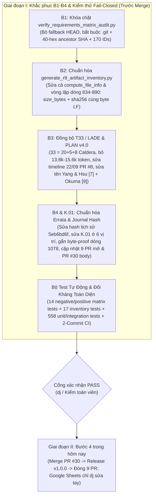

# Kế Hoạch Thực Thi & Kiểm Thử Dứt Điểm Dự Án RAG2ATT&CK (v4.0 — Final Closeout Remediation & Verification Plan)

## Mục Tiêu & Phạm Vi (Goal Description)

Kế hoạch **v4.0** này giải quyết triệt để **100% các phát hiện đã hội tụ** giữa Kiểm toán viên độc lập (vòng 1 & vòng 2) và Kiểm toán pháp y nội bộ trên nhánh `codex/finalization-20261003` ([PR #30](https://github.com/habachcp6/RAG2ATTCK/pull/30)), kèm theo **bộ kiểm thử tự động & kiểm chứng đối kháng toàn diện (Exhaustive Positive & Negative Test Suite)** để đảm bảo dự án đạt chuẩn nghiệm thu **`PASS` tuyệt đối ngay trong hôm nay**.

> [!IMPORTANT]
> **Nguyên tắc bất biến (Zero Experimental Drift):**
> 1. **Giữ nguyên 100% byte-for-byte** toàn bộ 22 tệp baseline được bảo vệ tại commit `80dbeb3fe2316e5d2d39de2ed6a5a2d15cfa9315` (21 tệp Git-tracked + 1 tệp STIX `attack/raw/enterprise-v19.2/enterprise-attack-19.2.json` trên máy trạm có SHA-256 `dc1639caa5501d720e280cf1cbd8fbe009884a0c9b3e6e9ed9d0c25166c3d8f4`).
> 2. **Giữ nguyên 100% byte-for-byte** 4 điểm neo thực nghiệm đã khóa:
>    - [`artifacts/results/canonical_metric_bundle_v2.json`](file:///<USER_HOME>/.codex/artifacts/rag2attck/finalization_repo_20261003/artifacts/results/canonical_metric_bundle_v2.json) (`49,465` B, SHA-256 `442b5933858caafc9da3c06ee9398637213ed30d7a7db80195c0babb1195ef34`)
>    - [`reports/evidence/canonical_run_seal_v1.json`](file:///<USER_HOME>/.codex/artifacts/rag2attck/finalization_repo_20261003/reports/evidence/canonical_run_seal_v1.json) (`3,046` B, SHA-256 `ae7a9ada86927a79e0c6916b44d3f0ba9e1f9756df55dd7b2fce712b35d48701`)
>    - [`reports/evidence/populated_report_slots_canonical.json`](file:///<USER_HOME>/.codex/artifacts/rag2attck/finalization_repo_20261003/reports/evidence/populated_report_slots_canonical.json) (`15,010` B, SHA-256 `7c5a37f2659035108a70b7f161114f5d35e6c903a5e77df1d395164fbb75e77e`)
>    - [`public_v4_candidate_20261003.zip`](file:///<USER_HOME>/.codex/artifacts/rag2attck/public_v4_candidate_20261003.zip) (`2,343,105` B, SHA-256 `1d5f9f4bb2d50bbb885746fe4d26f34ca5af1cacdbcad7e0005c2af8ea1086c1`)
> 3. **Giữ nguyên 100% byte-for-byte** 2 hồ sơ lịch sử R9 đã lưu trữ trong `reports/evidence/historical/`:
>    - [`r9_final_artifact_inventory_20261003.json`](file:///<USER_HOME>/.codex/artifacts/rag2attck/finalization_repo_20261003/reports/evidence/historical/r9_final_artifact_inventory_20261003.json) (`38,323` B, SHA-256 `a702d98e390635cdb8d9a10ad6cd5911aa1e77cebbc8bc6111e070925ac30fa9`)
>    - [`visual_qa_inspection_record_20261003.json`](file:///<USER_HOME>/.codex/artifacts/rag2attck/finalization_repo_20261003/reports/evidence/historical/visual_qa_inspection_record_20261003.json) (`15,697` B, SHA-256 `dd3e5d5a0e61bf7aef233376f52256ec7c06a2cbea266963d154146acbae8da5`)

---

## User Review Required

> [!WARNING]
> **Lộ trình hoàn tất dự án trong hôm nay & Quy tắc bất khả xâm phạm đối với Google Sheets:**
> - **Quy tắc tuyệt đối về Google Sheets:** Agent **CHỈ ĐƯỢC PHÉP ĐỌC** Google Sheets, **TUYỆT ĐỐI KHÔNG ĐƯỢC CHỈNH SỬA / GHI ĐÈ** bất kỳ ô nào trên Google Sheets ở mọi giai đoạn. Mọi cập nhật trên Google Sheets sẽ do chính `dj` duyệt và chỉnh sửa tay (Agent chỉ xuất bảng gợi ý nội dung từng ô trong báo cáo bàn giao để `dj` tham khảo).
> - **Giai đoạn I (Thực thi ngay — Hoàn tất Bước 0–3 v4.0 trên nhánh ứng viên PR #30):**
>   Sửa dứt điểm toàn bộ `B1`, `B2`, `B3`, `B4b`, `K.01` (`request_journal.jsonl` hash), `line 1078` (`rag_k1_predictions.jsonl` byte proof), danh sách 9 PR mở (`#8, #24–#29, #36, #37`), chạy bộ test dương tính + âm tính mở rộng, đẩy 2 commit chuẩn lên PR #30 (`codex/finalization-20261003`), đợi 4 lượt GitHub Actions CI xanh, cập nhật mô tả PR #30 và xuất bảng bàn giao 22 tệp khớp 100% SHA-256 tại `HEAD`. Giữ PR #30 ở trạng thái OPEN và 7 cổng `HUMAN_ACTION_GATE` ở trạng thái `PARTIAL`.
> - **Giai đoạn II (Sau khi Giai đoạn I được nghiệm thu `PASS` — Bước 4):**
>   Gỡ nhãn candidate sang trạng thái phát hành chính thức, merge PR #30 vào `main`, phát hành GitHub Release `v1.0.0-rag2attck-study` đính kèm `public_v4_candidate_20261003.zip`, và đóng 9 PR lịch sử bị thay thế (`#8, #24–#29, #36, #37`). (Google Sheets vẫn giữ nguyên Read-Only đối với Agent).

---

## Tổng Hợp Các Hạng Mục Sửa Chữa Đã Hội Tụ 100%



---

## Proposed Changes (Chi Tiết Thay Đổi Theo Từng Thành Phần)

### Thành Phần 1 — Khắc Phục `B1`: Khóa Chặt Verifier Ma Trận (`Fail-Closed`) & Kiểm Tra Phả Hệ Git

#### [MODIFY] [verify_requirements_matrix_audit.py](file:///<USER_HOME>/.codex/artifacts/rag2attck/finalization_repo_20261003/scripts/verify_requirements_matrix_audit.py)

1. **Bắt buộc ngữ cảnh Git thật (dòng 43–58, 159–162, 318–321):**
   - Xóa bỏ nhánh `else: blob_sha256 = disk_sha256` vốn cho phép trả về `PASS_ALL_BINDINGS_VERIFIED` khi không có `.git` hoặc khi truyền `--no-git-index-check`.
   - Nếu `not (repo_root / ".git").exists()` hoặc `not check_git_index` hoặc `git_tracked_files is None`, verifier lập tức trả về `audit_verdict = "FAIL_GIT_REPOSITORY_REQUIRED"` với `exit_code = 1` (không bao giờ cấp chứng nhận Git blob cho kiểm tra đĩa đơn thuần).
2. **Kiểm tra nghiêm ngặt cấu trúc và số lượng 170 yêu cầu (dòng 143–146):**
   - Kiểm tra `isinstance(requirements, list)` và `len(requirements) == 170` (`EXPECTED_REQUIREMENTS_COUNT = 170`), không có ID trùng lặp hoặc rỗng.
   - Nếu `requirements == []` hoặc `len(requirements) != 170` hoặc thiếu các trường bắt buộc (`id`, `title`, `evidence_locator`, `evidence_storage`, `evidence_type`, `final_candidate_status`), lập tức trả về `audit_verdict = "FAIL_INVALID_MATRIX_SCHEMA_OR_COUNT"` và `exit_code = 1`.
3. **Xóa bỏ hoàn toàn fallback `"HEAD"` và bắt buộc `evidence_commit_sha` hợp lệ + thuộc phả hệ `HEAD` (dòng 60–74, 294–317):**
   - Cập nhật hàm `_commit_is_valid_ancestor(repo_root: Path, commit_sha: str, cache: dict[str, bool]) -> bool`:
     - Bắt buộc `commit_sha` là chuỗi hex 40 ký tự (`re.fullmatch(r"[0-9a-f]{40}", commit_sha)` — từ chối `None`, `""`, `"0"*40`, `"deadbeef"*5`, hoặc SHA rút gọn).
     - Kiểm tra `git cat-file -e <commit_sha>^{commit}` (returncode `0`) **VÀ** `git merge-base --is-ancestor <commit_sha> HEAD` (returncode `0`).
   - Tại dòng 294–317 (áp dụng cho **cả** `git_tracked` lẫn `policy_code_reference`):
     ```python
     if not commit_sha or not _commit_is_valid_ancestor(repo_root, str(commit_sha), commit_cache):
         unresolved_local_locators.append(
             {
                 "requirement_id": req_id,
                 "title": title,
                 "evidence_locator": locator,
                 "evidence_storage": storage,
                 "evidence_commit_sha": commit_sha,
                 "final_candidate_status": status,
                 "reason": f"Invalid, missing, or non-ancestor evidence_commit_sha: {commit_sha!r}",
             }
         )
         continue

     ref_to_read = str(commit_sha)
     blob_sha256, blob_size = _get_git_blob_sha256_and_size(
         repo_root, ref_to_read, norm_locator, blob_cache
     )
     head_blob_sha256, _ = _get_git_blob_sha256_and_size(
         repo_root, "HEAD", norm_locator, blob_cache
     )
     ```
   - Không còn bất kỳ trường hợp nào tự động đổi `ref_to_read` sang `"HEAD"`.

---

### Thành Phần 2 — Khắc Phục `B2`: Đồng Bộ Tuyệt Đối `size_bytes` và `sha256` Theo Byte Thực Tế (LF) Trong Inventory

#### [MODIFY] [generate_r9_artifact_inventory.py](file:///<USER_HOME>/.codex/artifacts/rag2attck/finalization_repo_20261003/scripts/generate_r9_artifact_inventory.py)

1. **Nguyên tắc sửa:**
   - Giữ nguyên tuyệt đối byte của 8 tệp `.svg`, `plot_data.json` và `reports/evidence/figures/figure_provenance.json` (`88983822c84a7bb78247b17a5620f183dce3b4a96cf5ddf94a409aea5ecf388d`) để không phá vỡ bất kỳ điểm neo lịch sử nào.
   - Bổ sung bảng ánh xạ minh bạch `CANONICAL_TEXT_FIGURE_LF_HASHES` (lấy từ [`docs/report/figures/figure_provenance.json`](file:///<USER_HOME>/.codex/artifacts/rag2attck/finalization_repo_20261003/docs/report/figures/figure_provenance.json#L10-L38) cho `fig1..fig8.svg` và mã băm LF thực tế cho `plot_data.json`):
     - `fig1_system_architecture.svg`: LF `7623e1c20792b1c90c97064387bdef99014f11e6d91635bce272a89fa06c97b1` (`7,784` B) | CRLF provenance `390a20d82453ece92e29ac30bf8ddd24409831745125a5c8ee76a0e91770eeb2` (`7,863` B)
     - `fig2_accuracy_vs_k.svg`: LF `1bddfd900b4e5bb20d90b2a68064cb5e2aa0a58066a14641e5f128958ecaa2b4` (`6,560` B) | CRLF provenance `f6c6358497d9cb074de1ec2da3363332b3f53f93fc90a56d7f3efa9306e6f721` (`6,629` B)
     - `fig3_macro_f1_vs_k.svg`: LF `aff69a0bd3cfb37948a73e4ead5d885670f426e3e0132d3a1f13f536bf7acd28` (`4,056` B) | CRLF provenance `3250dd2c52f108d9717d5d4607eb07e4052b11135e53a6e6731380df9c5de42e` (`4,104` B)
     - `fig4_retrieval_hit_rate.svg`: LF `c01c563727549f73a48d3c4a9c24dc391e023d4ea5a930958f4ffb736e8c937f` (`4,074` B) | CRLF provenance `2c7bacf2d80753bceb9b863c59dad89011902811662ddbab3512bac9956ee7cf` (`4,119` B)
     - `fig5_conditional_accuracy.svg`: LF `1d7497283ae0537c52e88a5e00803d0381e1b62ec5e44471e75ed5090bdb14a9` (`5,733` B) | CRLF provenance `80090de1cd54b04c0758bb3eeabfc0114b5b485421d851e4aa711efe3b31050f` (`5,793` B)
     - `fig6_latency_vs_k.svg`: LF `a1b192768437b61fa2a0a0eea82c19011a75a8005639000fae77019e1a281b2a` (`5,892` B) | CRLF provenance `451180e694aaec17b263da35894ef3bc577aed6da44ac1628ce70ab0580b00c5` (`5,954` B)
     - `fig7_cost_and_tokens_vs_k.svg`: LF `38349b81e25574b8bd8424e5e7a251b7c2d1a5c0344a6ed2b8cced98a50d8431` (`6,734` B) | CRLF provenance `b0194313704b0672ebb8c664192bb7f85d2dedefd7fc04c9dca06dab2c687255` (`6,805` B)
     - `fig8_failure_decomposition.svg`: LF `2cd89e99326650fa9ab069d2f83c13ef23dedbcaea0e75c5360a5e0082c65ba5` (`3,824` B) | CRLF provenance `b90d61d4fcd806c3affb1ef017dcf7aacad1c09a4b4e4a5dbf7421b6306f4e6c` (`3,858` B)
     - `plot_data.json`: LF `e6515f6ae89f0b98539eceb526a0d8bd0e72558d393c333345248b512912f375` (`3,760` B) | CRLF provenance `965452e7d84e6522f1c0a673ae6e1cd9e92e765a89b222fab2213c8ffbe7f4ac` (`3,891` B)
2. **Sửa ở CẢ HAI nhánh (`compute_file_info()` tại dòng 76–97 VÀ vòng lặp `scientific_figures_inventory.files` tại dòng 834–890):**
   - Không bao giờ ghi đè `actual_sha` / `computed_sha` bằng `crlf_sha`.
   - Trường `"size_bytes": len(raw)`, `"sha256": raw_sha256`, và `"expected_sha256": expected_raw_sha256` luôn biểu diễn **cùng một chuỗi byte thực tế (LF)** trên Git/đĩa.
   - Khi tệp văn bản (`.svg`, `.json`) có mã băm khai báo trong `reports/evidence/figures/figure_provenance.json` ở dạng CRLF, kiểm tra đồng thời `raw_sha256 == expected_lf_sha256` **và** `crlf_sha256 == provenance_crlf_sha256`, sau đó lưu tách biệt vào các trường phụ:
     - `"provenance_crlf_sha256": provenance_crlf_sha256`
     - `"crlf_normalized_sha256": crlf_sha256`
     - `"crlf_normalized_size_bytes": len(crlf_bytes)`
     - `"line_ending_normalization": "git_lf_raw_verified_against_windows_crlf_provenance"`

---

### Thành Phần 3 — Khắc Phục `B3`: Đồng Bộ Học Thuật `T33` (LADE), Timeline Lịch Sử & Kế Hoạch `PLAN`

#### [MODIFY] [t33_lade_claim_verification_record.json](file:///<USER_HOME>/.codex/artifacts/rag2attck/finalization_repo_20261003/reports/evidence/t33_lade_claim_verification_record.json)
1. **Sửa `remediated_claims.primary_dataset.verified_value` (dòng 48):**
   - Thay dấu cộng gây hiểu lầm (`33 sequences per 2:1 setting + 5 lateral-movement + 8 multi-stage`) bằng cấu trúc bao gồm chính xác theo trang 13–14 của `LADE-2026.pdf`:
     `"AVIATOR (35 attack / 32 benign sequences) & Caldera-derived dataset (two sets of 33 APT sequences for 2:1 and 10:1 benign-to-APT ratio settings, each comprising 20 adversary-profile sequences and 13 MITRE emulation-plan sequences [including 5 lateral-movement and 8 multi-stage attack sequences], plus 33 benign sequences)"`.
2. **Sửa `remediated_claims.token_overhead` $\rightarrow$ `context_window_and_segmentation` (dòng 80–87):**
   - Xóa bỏ hoàn toàn con số không có thật `~13.8k-15.6k input tokens per window for gpt-oss-120B (Table 2, page 12)`.
   - Thay bằng thông số có thật kèm trích dẫn nguyên văn:
     - `Section 4.1 (Context Building), page 8`: Mỗi phân đoạn (segment) được giới hạn ở tối đa **70% cửa sổ ngữ cảnh** của mô hình.
     - `Section 5.2 (APT Detection), page 14`: `gpt-oss-120B`, `Llama-3.3-70B`, và `Mistral-Small-3.2-24B` sử dụng cửa sổ `128k` tokens với giới hạn phân đoạn hiệu dụng $\approx 89,600$ tokens (`Gemini-2.5-Pro` sử dụng cửa sổ `1M` tokens không cần phân đoạn).
     - `Section 5.2, page 15`: Ghi chú rõ con số `13.8%` ở trang 15 là tỷ lệ đồng thuận bỏ phiếu `4–1` qua 5 lượt chạy (`76.3%` đồng thuận `5–0`, `13.8%` đồng thuận `4–1`, `10%` chia rẽ `3–2`), không phải số lượng token.
3. **Sửa `verification_timeline` (dòng 89–110) khớp 100% với lịch sử Git (`6783f209`):**
   - `Stage 1 (2026-09-22, PR #8 commit 6783f20971cbff91f105d0280ddd07cb0925aab0)`: Ghi nhận đúng rằng `reports/T33_related_work.md` tại `6783f209` đã ghi `Full-text content checks: 6/8` và đặt `LADE` (`https://www3.cs.stonybrook.edu/~stoller/papers/LADE-2026.pdf`, Sections 4, 5.1–5.4; pp. 12–16) ở trạng thái `FULL TEXT CHECKED` trên nhánh PR #8 (nhưng nhánh này chưa được merge vào `main` và cảnh báo các ghi chú `T02` cũ chỉ là đầu mối lịch sử).
   - `Stage 2 (2026-10-03, reports/evidence/supervisor_bibliography_review_20261003.md)`: Trong đợt kiểm tra lại độc lập trên nhánh `codex/finalization-20261003`, máy chủ Stony Brook gặp sự cố HTTP timeout tạm thời nên báo cáo lúc đó tạm lùi về mức bảo thủ `5/8` và còn sót thông tin mô hình/dữ liệu sơ bộ từ ghi chú `T02` cũ.
   - `Stage 3 (2026-10-19/20, Closeout Verification Pass)`: Tải lại thành công bản thảo 28 trang (`3,819,792` B, SHA-256 `6e8384569254bc4cf82dd4d0191746907ff40fa76016275946651cf47d6f4985`), đối chiếu từng dòng Bảng 1b và đồng bộ hóa toàn bộ hồ sơ.

#### [MODIFY] [scientific_report.md](file:///<USER_HOME>/.codex/artifacts/rag2attck/finalization_repo_20261003/docs/report/scientific_report.md), [canonical_populated_report.md](file:///<USER_HOME>/.codex/artifacts/rag2attck/finalization_repo_20261003/reports/evidence/canonical_populated_report.md), [T02_comparator_matrix.md](file:///<USER_HOME>/.codex/artifacts/rag2attck/finalization_repo_20261003/docs/related_work/T02_comparator_matrix.md), [supervisor_bibliography_review_20261003.md](file:///<USER_HOME>/.codex/artifacts/rag2attck/finalization_repo_20261003/reports/evidence/supervisor_bibliography_review_20261003.md)
- Tại Bảng 1b Dòng 14 (`Primary Dataset` cột `LADE (Gwak et al., 2026/2027) [12]`):
  Sửa từ `AVIATOR (35/32 seqs) & Caldera-derived (33 seqs per 2:1 setting + 5 lateral + 8 multi-stage)`
  thành:
  `AVIATOR (35/32 seqs) & Caldera-derived (33 APT seqs per 2:1 & 10:1 setting [including 20 profile, 5 lateral, 8 multi-stage] + 33 benign)`
- Tại Bảng 1b Dòng 16 (`Key Difference` cột `LADE`):
  Sửa thành:
  `Prompting only (no RAG); AVIATOR (35/32 seqs) & Caldera-derived (33 APT seqs per 2:1 & 10:1 setting, including 5 lateral & 8 multi-stage)`
- Đồng bộ tương tự trong `docs/related_work/T02_comparator_matrix.md` và `reports/evidence/supervisor_bibliography_review_20261003.md`.
- Biên dịch lại `docs/report/scientific_report.docx` $\rightarrow$ sao chép byte-identical sang `reports/evidence/canonical_populated_report.docx` $\rightarrow$ kết xuất lại `reports/evidence/canonical_populated_report.pdf` (41 trang) và cập nhật `reports/evidence/qa/visual_qa_inspection_record.json`.

#### [MODIFY] [PLAN-rag2attck-closeout.md](file:///<USER_HOME>/.codex/artifacts/rag2attck/finalization_repo_20261003/docs/PLAN-rag2attck-closeout.md)
- Đồng bộ toàn văn kế hoạch v4.0 vào `docs/PLAN-rag2attck-closeout.md` trong repo:
  - Sửa tên và số hiệu 2 bài giới hạn truy cập (`metadata-only / UNVERIFIED`) thành **`Yang & Hsu (2026) [7]`** và **`Okuma et al. (2023) [9]`** (xóa bỏ lỗi gọi LADE là `[6]` và xếp nhầm `Gwak et al. [11]` vào nhóm metadata-only).
  - Sửa công thức Caldera (`33 = 20 + 5 + 8`), bỏ số liệu `13.8k–15.6k tokens`, sửa mã băm `request_journal.jsonl` thành `f36e0f3099ef704e6ed5e0bc0097affbe98932e1620563a6db22e631ae114f31`, ghi rõ SHA baseline đầy đủ `80dbeb3fe2316e5d2d39de2ed6a5a2d15cfa9315`, phân biệt `141` bindings tới `21` tệp duy nhất, liệt kê đúng 9 PR mở (`#8, #24–#29, #36, #37`) tách biệt với 2 PR đã merge trước đó (`#31, #32`), và ghi đúng 4 tab Google Sheets (`Overview`, `Roadmap`, `RQ_Experiments`, `Resources`).

---

### Thành Phần 4 — Khắc Phục `B4b`, `K.01` Journal Hash & Bằng Chứng Byte Dòng `1078`

#### [MODIFY] [report_revision_errata_record.json](file:///<USER_HOME>/.codex/artifacts/rag2attck/finalization_repo_20261003/reports/evidence/report_revision_errata_record.json) & [report_revision_errata_record.md](file:///<USER_HOME>/.codex/artifacts/rag2attck/finalization_repo_20261003/reports/evidence/report_revision_errata_record.md)
1. **Sửa `artifact_hash_transitions` khớp 100% với Git blob tại R14 (`5eb6bd6f4b45724f0a8fb89a77b42f6000c3d383`):**
   - `canonical_populated_report_md` & `docs_scientific_report_md`:
     - `historical_commit_sha`: `"5eb6bd6f4b45724f0a8fb89a77b42f6000c3d383"`
     - `historical_size_bytes_lf`: `105354`
     - `historical_sha256_lf`: `"5cbaa094095adbd163c0ea516a32df799e9a9af9efb35c47b40c04c6fc44858d"`
     - `historical_size_bytes_crlf`: `106090`
     - `historical_sha256_crlf`: `"0cc9a5b971f383c49736b13fb28612f3dc7e7e8f55be9cd47b78dc9b2e87eb0f"`
   - `docs_scientific_report_docx`:
     - `historical_size_bytes`: `320049` (thay cho `320899`)
     - `historical_sha256`: `"43297b17b2a505fdad96e94ac88fdc868e412bc493682be5e1bdc048bc0bb2dd"`
   - Cập nhật `new_sha256` và `new_size_bytes` khớp với bộ báo cáo `.md`, `.docx`, `.pdf` mới sinh ở Thành phần 3.
2. **Sửa `ERR-03` (`rag_k1_predictions.jsonl` dòng `1078`) kèm chuỗi chứng thực byte 4 bước:**
   - Sửa `line 1179` thành **`line 1078` (1-based physical line index)** và bổ sung trường cấu trúc `prediction_record_byte_verification` vào `report_revision_errata_record.json`:
     ```json
     "prediction_record_byte_verification": {
       "package_zip_locator": "artifacts/packages/public_v4_candidate_20261003.zip",
       "package_zip_size_bytes": 2343105,
       "package_zip_sha256": "1d5f9f4bb2d50bbb885746fe4d26f34ca5af1cacdbcad7e0005c2af8ea1086c1",
       "member_path": "base_public_v3/inputs/rag_k1_predictions.jsonl",
       "member_size_bytes": 2292294,
       "member_total_lines": 1280,
       "member_sha256": "745cb883a90b4d1bac7c76c4007b143893834530a843e153fc24277aae5da7ac",
       "matches_canonical_run_seal_v1": true,
       "physical_line_1based": 1078,
       "physical_line_0based": 1077,
       "raw_line_length_bytes_without_lf": 1796,
       "raw_line_sha256_algorithm": "sha256(raw_line_bytes_without_newline)",
       "raw_line_sha256": "e9146fe74aa5769faa5dc7df70205e62924fcf8c0e3a53946c50f96ddb2f8086",
       "matches_request_journal_line_48485_record_sha256": true,
       "record_identifiers": {
         "run_id": "live-66b94b1676bf46a9",
         "sample_id": "view_d870d574",
         "pair_id": "pair_3598584c",
         "condition": "rag_k1",
         "request_attempt_count": 2,
         "retry_count": 1,
         "response_id": "resp_0efb218e56a6ecc1006abf0be6419887d0bca3815a8a0b3f0d"
       }
     }
     ```

#### [MODIFY] [update_requirements_matrix_r9.py](file:///<USER_HOME>/.codex/artifacts/rag2attck/finalization_repo_20261003/scripts/update_requirements_matrix_r9.py)
- Tại dòng 639–644 (`K.01-PROVIDER_FAILURE_RETRY`):
  - Đọc trực tiếp `request_journal_sha = seal_data["sealed_artifact_digests"]["request_journal.jsonl"]` từ `reports/evidence/canonical_run_seal_v1.json` (và assert bằng `"f36e0f3099ef704e6ed5e0bc0097affbe98932e1620563a6db22e631ae114f31"`), thay thế hoàn toàn chuỗi sai `f36e0f3099ef704e05a21d0839cf3158268fb36b647d8c229bc9f8cf8fd4149a`.
  - Bổ sung tham chiếu `rag_k1_predictions.jsonl` (`sha256=745cb883a90b4d1bac7c76c4007b143893834530a843e153fc24277aae5da7ac`, 1-based physical line `1078`, `record_sha256=e9146fe74aa5769faa5dc7df70205e62924fcf8c0e3a53946c50f96ddb2f8086`) vào `closure_step` của `K.01`.
  - Tái sinh đồng bộ cả 3 tệp ma trận:
    - `reports/evidence/finalization_requirements_matrix.json`
    - `reports/evidence/finalization_requirements_matrix.md`
    - `docs/audit/requirements_traceability_matrix.md`

---

## Verification Plan (Kế Hoạch Kiểm Thử Kỹ Lưỡng Để Đóng Dự Án Trong Hôm Nay)

Để đảm bảo không còn bất kỳ lỗ hổng nào có thể bị bắt lỗi ở vòng nghiệm thu cuối, chúng ta thiết lập **4 tầng kiểm thử tự động & đối kháng (4-Tier Exhaustive Verification Suite)**:

### Tầng 1 — Bộ Test Đối Kháng & Hồi Quy Cho Verifier Ma Trận (`tests/test_requirements_matrix_audit.py`)
Cập nhật [`tests/test_requirements_matrix_audit.py`](file:///<USER_HOME>/.codex/artifacts/rag2attck/finalization_repo_20261003/tests/test_requirements_matrix_audit.py) để kiểm tra **toàn bộ 14 kịch bản dương tính & âm tính trên Git thật (`check_git_index=True`)**:
1. **`test_real_requirements_matrix_passes_with_zero_local_exceptions`**: Kiểm tra ma trận thật đạt `PASS_ALL_BINDINGS_VERIFIED` (`exit_code == 0`, `170` requirements, `141` git blob bindings tới `21` tệp duy nhất, `29` non-git assets, `0` lỗi).
2. **`test_k01_retry_locator_matches_canonical_run_seal`**: Đọc `reports/evidence/canonical_run_seal_v1.json`, lấy đủ 64 ký tự của `sealed_artifact_digests["request_journal.jsonl"]` (`f36e0f3099ef704e6ed5e0bc0097affbe98932e1620563a6db22e631ae114f31`) và `sealed_artifact_digests["rag_k1_predictions.jsonl"]` (`745cb883...`), assert cả hai mã băm 64 ký tự và `line 1078` + `48479-48482` xuất hiện chính xác trong `K.01["closure_step"]`, đồng thời assert chuỗi hash hỏng cũ (`...05a21d08...`) **không tồn tại ở bất kỳ đâu** trong ma trận hay `PLAN`.
3. **`test_zero_commit_sha_fails_closed` (Ca thử âm tính #1 của Kiểm toán viên)**: Gán `evidence_commit_sha = "0" * 40` $\rightarrow$ bắt buộc `exit_code == 1` và `audit_verdict != "PASS_ALL_BINDINGS_VERIFIED"`.
4. **`test_non_existent_deadbeef_commit_sha_fails_closed` (Ca thử âm tính #2 của Kiểm toán viên)**: Gán `evidence_commit_sha = "deadbeef" * 5` $\rightarrow$ bắt buộc `exit_code == 1`.
5. **`test_missing_or_empty_commit_sha_fails_closed` (Ca thử âm tính #3 của Kiểm toán viên)**: Xóa `evidence_commit_sha` (`None` và `""`) trên cả `git_tracked` lẫn `policy_code_reference` $\rightarrow$ bắt buộc `exit_code == 1`.
6. **`test_short_or_malformed_commit_sha_fails_closed`**: Gán `evidence_commit_sha = "82c586b"` (7 ký tự) hoặc `"zzzz..."` $\rightarrow$ bắt buộc `exit_code == 1`.
7. **`test_empty_or_incomplete_requirements_list_fails_closed` (Ca thử âm tính #6 của Kiểm toán viên)**: Đặt `requirements = []` hoặc `requirements = requirements[:169]` hoặc trùng lặp ID $\rightarrow$ bắt buộc `exit_code == 1` và `audit_verdict == "FAIL_INVALID_MATRIX_SCHEMA_OR_COUNT"`.
8. **`test_missing_git_directory_or_disabled_git_index_fails_closed` (Ca thử âm tính #7 của Kiểm toán viên)**: Chạy verifier trên bản sao thư mục không có `.git` hoặc truyền `check_git_index=False` $\rightarrow$ bắt buộc `exit_code == 1` và `audit_verdict == "FAIL_GIT_REPOSITORY_REQUIRED"` (tuyệt đối không trả `PASS_ALL_BINDINGS_VERIFIED`).
9. **`test_unresolved_local_locator_fails_closed` (Ca thử âm tính #4 của Kiểm toán viên)**: Trỏ tới tệp local không tồn tại (`docs/audit/non_existent_artifact.json`, `AGENTS.md`) trên Git thật (`check_git_index=True`) $\rightarrow$ bắt buộc `exit_code == 1` và `audit_verdict == "FAIL_UNRESOLVED_LOCAL_LOCATOR"`.
10. **`test_git_blob_hash_mismatch_fails_closed` (Ca thử âm tính #5 của Kiểm toán viên)**: Thay `evidence_hash = "0" * 64` trên Git thật (`check_git_index=True`) $\rightarrow$ bắt buộc `exit_code == 1` và `audit_verdict == "FAIL_GIT_BLOB_HASH_MISMATCH"`.
11. **`test_premature_human_gate_verified_status_fails_closed`**: Đổi `C.03-HUMAN_MERGE_AUTH` sang `VERIFIED` $\rightarrow$ bắt buộc `exit_code == 1` và `audit_verdict == "FAIL_INVALID_URL_OR_GATE_BINDING"`.
12. **`test_git_tracked_missing_hash_fails_closed`**: Xóa `evidence_hash = None` trên yêu cầu `git_tracked` $\rightarrow$ bắt buộc `exit_code == 1`.
13. **`test_git_blob_vs_disk_hash_verification_with_git_index_enabled`**: Giả lập lệch hash giữa Git blob và đĩa $\rightarrow$ bắt buộc `exit_code == 1`.

### Tầng 2 — Bộ Test Kiểm Tra Toàn Vẹn Byte-vs-Hash Cho Inventory (`tests/test_artifact_inventory.py`)
Bổ sung 2 bài kiểm thử mới vào [`tests/test_artifact_inventory.py`](file:///<USER_HOME>/.codex/artifacts/rag2attck/finalization_repo_20261003/tests/test_artifact_inventory.py) (nâng tổng số lên 17 bài test):
1. **`test_all_inventory_entries_match_raw_disk_and_git_bytes_exact`**: Quét đệ quy toàn bộ 59 đối tượng tệp (238 trường metadata) trong `r9_final_artifact_inventory.json` và `closeout_rc_artifact_inventory.json`:
   - Assert `entry["size_bytes"] == len(raw_bytes)`
   - Assert `entry["sha256"] == hashlib.sha256(raw_bytes).hexdigest()`
   - Assert `entry["expected_sha256"] == hashlib.sha256(raw_bytes).hexdigest()` (nếu `expected_sha256 is not None`)
   - Đặc biệt kiểm tra cả 9 tệp (`fig1..fig8.svg` và `plot_data.json`) có `sha256 == expected_sha256 == LF_SHA256` và `provenance_crlf_sha256 == CRLF_SHA256`.
2. **`test_errata_historical_and_new_hashes_match_git_blobs`**: Đối chiếu tự động từng mục trong `artifact_hash_transitions` của `reports/evidence/report_revision_errata_record.json` với `git show 5eb6bd6f4b45724f0a8fb89a77b42f6000c3d383:<path>` (cho các trường `historical_*`) và với tệp hiện hành trên đĩa/Git (cho các trường `new_*`), đảm bảo `0` sai lệch kích thước hay mã băm.

### Tầng 3 — Chạy Toàn Bộ Các Cổng Kiểm Định Độc Lập & Bộ 560+ Pytest Ngoại Tuyến
Chạy tuần tự các lệnh sau tại `<USER_HOME>\.codex\artifacts\rag2attck\finalization_repo_20261003` và bắt buộc toàn bộ trả về `exit_code == 0`:
```powershell
python scripts/verify_report_metadata.py
python scripts/check_cross_artifact_consistency.py --strict --scope all --metric-bundle artifacts/results/canonical_metric_bundle_v2.json --expected-bundle-sha256 442b5933858caafc9da3c06ee9398637213ed30d7a7db80195c0babb1195ef34
python scripts/generate_r9_artifact_inventory.py
python scripts/run_sg_evidence_audit_probes.py
python scripts/verify_requirements_matrix_audit.py
python scripts/run_offline_tests.py -m pytest -q
```

### Tầng 4 — Giao Thức 2-Commit, Kiểm Tra 4 Lượt GitHub Actions CI & Đồng Bộ Bảng Bàn Giao
1. **Commit 1 (`<closeout_evidence_sha_v4>`):** Commit toàn bộ code verifier/generator/test, báo cáo `.md`/`.docx`/`.pdf`, `PLAN-rag2attck-closeout.md`, `t33_lade_claim_verification_record.json`, `report_revision_errata_record.{json,md}`, `visual_qa_inspection_record.json`, và `r9_final_artifact_inventory.json` / `closeout_rc_artifact_inventory.json`. Push lên `origin/codex/finalization-20261003` và đợi cả 2 workflow (`CI` và `Real Retrieval Integration`) hoàn tất `success`.
2. **Commit 2 (`<final_head_sha_v4>`):** Chạy `scripts/update_requirements_matrix_r9.py` và `scripts/verify_requirements_matrix_audit.py` ghim đúng `<closeout_evidence_sha_v4>` và URL CI run của Commit 1; chỉ commit đúng 4 tệp ma trận/audit (`docs/audit/requirements_traceability_matrix.md`, `reports/evidence/finalization_requirements_matrix.json`, `reports/evidence/finalization_requirements_matrix.md`, `reports/evidence/matrix_git_blob_audit_report.json`). Push lên `origin/codex/finalization-20261003` và đợi cả 2 workflow (`CI` và `Real Retrieval Integration`) hoàn tất `success`.
3. **Cập nhật mô tả PR #30 & Kiểm tra tự động bảng bàn giao 22 tệp:**
   - Cập nhật PR #30 body phản ánh đúng `<final_head_sha_v4>`, `141` git blob bindings (`21` tệp duy nhất) và 4 lượt CI mới nhất.
   - Dùng script Python sinh trực tiếp bảng 22 tệp từ `git show HEAD:<path>` để đảm bảo **22/22 kích thước và 22/22 SHA-256 khớp tuyệt đối 100%**.
