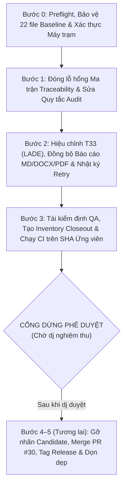

# Kế Hoạch Đóng Dự Án RAG2ATTCK — Phiên Bản v3.0 (Authoritative Closeout Plan)

**Dự án:** `habachcp6/RAG2ATTCK`  
**Nhánh ứng viên hiện tại:** `codex/finalization-20261003` (PR #30, HEAD ban đầu: `5eb6bd6f4b45724f0a8fb89a77b42f6000c3d383`)  
**Phương án chủ đạo:** **Phương án A (Hiệu chỉnh) — Hiệu chỉnh báo cáo có quản lý phiên bản và bảo toàn bằng chứng lịch sử** (*Versioned Report Remediation with Historical Evidence Preservation*), kết hợp **Biên bản Đính chính & Truy vết Phiên bản** (vai trò lưu trữ lịch sử của Phương án B).  
**Ranh giới thực thi hiện tại:** Chỉ thực thi từ **Bước 0 đến Bước 3**, xuất gói bằng chứng tại đúng SHA ứng viên hiệu chỉnh (`corrected release candidate`) và **DỪNG LẠI** chờ phê duyệt cuối cùng trước khi merge PR #30, phát hành Release chính thức, đóng 9 PR cũ hoặc cập nhật Google Sheet Tracker.

---

## 1. Tóm Tắt Quyết Định Chiến Lược & Các Nguyên Tắc Bất Biến

> [!IMPORTANT]
> **Nguyên tắc cốt lõi của Phương án A (Hiệu chỉnh):**
> 1. **Bảo toàn tuyệt đối dữ liệu thực nghiệm và bằng chứng lịch sử:** Giữ nguyên 100% byte đối với `canonical_metric_bundle_v2.json` (`442b5933...`), `canonical_run_seal_v1.json` (`ae7a9ada...`), gói dữ liệu `public_v4_candidate_20261003.zip` (`1d5f9f4b...`), và 22 file hạ tầng được bảo vệ từ baseline `80dbeb3f`.
> 2. **Sửa sạch sản phẩm khoa học sẽ công bố:** Giải quyết triệt để mâu thuẫn trích dẫn/mô hình của bài LADE (`T33`), đồng bộ hóa 100% nội dung và byte giữa hai đường dẫn DOCX (`reports/evidence/canonical_populated_report.docx` và `docs/report/scientific_report.docx`) cùng bản PDF (`reports/evidence/canonical_populated_report.pdf`), và chuẩn hóa nhãn trạng thái tài liệu theo đúng vòng đời phê duyệt.
> 3. **Không ngụy tạo chứng nhận cũ cho bản build mới:** Không âm thầm thay mã băm trong `r9_final_artifact_inventory.json` rồi giữ nguyên các cờ nghiệm thu lịch sử (`timestamp_utc: 2026-10-03T12:55:00Z`, `VISUALLY_REVIEWED = true` của bản `c5ce49f7...`). Bản inventory R9 cũ và hồ sơ QA cũ được bảo tồn nguyên vẹn trong lịch sử Git và lưu trữ tường minh tại `reports/evidence/historical/`; bản ứng viên hiệu chỉnh phải trải qua quy trình kiểm định cấu trúc, số học và thị giác mới độc lập kèm biên bản đính chính (`errata record`).

### Bảng Phân Định Xử Lý Theo Thành Phần

| Thành phần | Cách xử lý trong Kế hoạch v3.0 |
| :--- | :--- |
| **Dữ liệu thực nghiệm, ground truth, protocol (`config/experiment_protocol_v1.json`) và `canonical_metric_bundle_v2.json`** | Giữ nguyên tuyệt đối (0 byte thay đổi); kiểm tra lại SHA-256 đối chiếu với danh sách 22 file bảo vệ. |
| **Gói dữ liệu công khai `public_v4_candidate_20261003.zip`** | Giữ nguyên byte (`2,343,105 bytes`, SHA-256 `1d5f9f4bb2d50bbb885746fe4d26f34ca5af1cacdbcad7e0005c2af8ea1086c1`); xác thực lại manifest (`dbc2e133...`) và chạy lại kiểm thử replay ngoại tuyến. |
| **Báo cáo khoa học (`.md`, `.docx`, `.pdf`), Bảng 1b và tài liệu related work (`T02`/`T33`)** | Tạo revision hiệu chỉnh tại commit mới; biên dịch DOCX từ một nguồn Markdown duy nhất, sao chép đồng bộ sang cả hai đường dẫn để khớp byte 100%, và kết xuất lại PDF 41 trang. |
| **Bản báo cáo cũ (`5cbaa094...`, `c5ce49f7...`, `43297b17...`) và Inventory R9 (`9a69d8c0...`)** | Giữ truy xuất đầy đủ tại commit lịch sử `5eb6bd6f` / `1cd0a556` và lưu bản sao bất biến vào `reports/evidence/historical/r9_final_artifact_inventory_20261003.json` cùng `reports/evidence/historical/visual_qa_inspection_record_20261003.json`. |
| **Inventory và Visual QA phục vụ bản ứng viên hiệu chỉnh** | Phát hành `reports/evidence/closeout_rc_artifact_inventory.json` và cập nhật `reports/evidence/r9_final_artifact_inventory.json` + `reports/evidence/qa/visual_qa_inspection_record.json` với `timestamp_utc` mới, `source_sha` mới, trường liên kết `supersedes_historical_inventory`, và bằng chứng kiểm định thị giác mới thực tế. |
| **Biên bản đính chính & truy vết phiên bản (`Errata & Revision Lineage`)** | Tạo `reports/evidence/report_revision_errata_record.json` và `.md` ghi rõ quan hệ giữa revision cũ và revision mới, danh mục từng vị trí sửa, nguyên nhân sửa, và phạm vi dữ liệu thực nghiệm không thay đổi. |

---

## 2. Kết Quả Kiểm Chứng Thực Chứng Sơ Bộ (Pre-Execution Forensic Verification)

Trước khi lập bản kế hoạch v3.0 này, các điểm nghi vấn trong phản biện đã được kiểm tra trực tiếp trên dữ liệu gốc để đảm bảo kế hoạch sửa đúng bản chất kỹ thuật:

### 2.1. Xác minh toàn văn manuscript `LADE-2026.pdf` và giải phẫu mâu thuẫn `T33`
- **Bản lưu manuscript đã thu thập:** Tải trực tiếp từ `https://www3.cs.stonybrook.edu/~stoller/papers/LADE-2026.pdf`, kích thước `3,819,792 bytes`, 28 trang, SHA-256: `6e8384569254bc4cf82dd4d0191746907ff40fa76016275946651cf47d6f4985` (lưu tại `<USER_HOME>\.gemini\antigravity\brain\78634c79-d8ab-40b0-94f0-6e4db79fc0b0\scratch\LADE-2026.pdf`).
- **Kết quả đối chiếu từng dòng với báo cáo hiện tại:**
  1. **Sai lệch mô hình trong Bảng 1b Dòng 12 (`Primary Models`):** Báo cáo hiện tại (`canonical_populated_report.md` dòng 133 và `scientific_report.md`) ghi LADE sử dụng **`GPT-4, Claude-3-Opus, Llama-3-70B`**. Trong khi đó, manuscript `LADE-2026.pdf` tại **Mục `§5`, trang 12, Bảng 2** ghi rõ 4 mô hình thực tế được đánh giá là: **`gpt-oss-120B`, `Llama-3.3-70B`, `Mistral-Small-3.2-24B`, và `Gemini-2.5-Pro`**. Truy vết lịch sử cho thấy `docs/related_work/T02_comparator_notes.md` chỉ ghi chung `"Commercial / open LLM prompting engines"`, và khi điền Bảng 1b ở vòng trước đã xảy ra lỗi suy diễn sai tên mô hình.
  2. **Thiếu hụt bộ dữ liệu trong Bảng 1b Dòng 14 & Dòng 16 (`Primary Dataset`):** Bảng 1b hiện chỉ ghi `AVIATOR (35 attack / 32 benign sequences)`, bỏ sót bộ dữ liệu thứ hai được đánh giá trong **Mục `§5.1`, trang 12–13**: **`Caldera-derived dataset`** (mỗi tập gồm 33 chuỗi theo tỷ lệ 2:1 benign-to-APT, cộng 5 chuỗi lateral-movement và 8 chuỗi multi-stage attack).
  3. **Sai lệch trong `docs/related_work/T02_comparator_matrix.md` Dòng 13:** Vẫn ghi nguồn dữ liệu của LADE là `DARPA TC & simulated APT scenarios`, trong khi `LADE-2026.pdf §5.1 (tr. 12)` nêu rõ DARPA TC E3/E5, Linux APT Dataset, DARPA OpTC và ATLAS-v2 là các bộ dữ liệu cũ không phù hợp và bài báo sử dụng **AVIATOR + Caldera-derived emulation plans**.
- **Kết luận xử lý `T33`:** Thực hiện đối chiếu claim theo phiên bản có lưu hash (`6e838456...`), ngày truy xuất (`2026-10-19`), và vị trí trang/mục (`§4, §5.1–5.5, tr. 7–19`). Sau khi sửa chính xác 3 điểm sai lệch trên dựa trên bản full-text đã lưu, số bài được xác minh toàn văn trong nhóm 8 bài có liên kết bên ngoài là **`6/8`** (chỉ còn 2 bài `[8]` Okuma et al. và `[11]` Gwak et al. là `metadata-only / UNVERIFIED`), đồng thời ghi nhận rõ đây là đợt xác minh bổ sung phục vụ closeout (tách biệt với lần kiểm tra ngày 2026-09-22 ở PR #8 và sự cố timeout ngày 2026-10-03).

### 2.2. Đối chiếu trực tiếp cấu trúc XML giữa 2 file DOCX hiện tại
- Đã giải nén `word/document.xml` (1.000 đoạn văn `w:p`) của cả hai file DOCX tại HEAD hiện tại:
  - `reports/evidence/canonical_populated_report.docx` (`320,008 bytes`, SHA-256: `c5ce49f7e57ee2d86d79daab50def273af6dbb4c4393da61340f033b63306ccb`)
  - `docs/report/scientific_report.docx` (`320,049 bytes`, SHA-256: `43297b17b2a505fdad96e94ac88fdc868e412bc493682be5e1bdc048bc0bb2dd`)
- **Kết quả `unified_diff`:** Xác nhận hai file DOCX **có khác biệt nội dung văn bản khoa học tại 6 đoạn văn** (không chỉ khác metadata ZIP):
  - **Đoạn văn thứ 42 (Mục 1.3):** Bản `c5ce49f7...` liệt kê 3 bài (`LADE [6], Okuma et al. [8], Gwak et al. [11]`) là metadata-only, trong khi bản `43297b17...` đã rút xuống còn 2 bài (`Okuma et al. [8], Gwak et al. [11]`).
  - **5 ô dữ liệu cột `Okuma et al. (2025) [8]` trong Bảng 1b:** Bản `c5ce49f7...` vẫn giữ các giá trị chưa kiểm chứng (`Technique level (Txxxx)`, `N/A`, `No`, `N/A`, `No`), trong khi bản `43297b17...` đã chuyển sang `UNVERIFIED`.

### 2.3. Đối chiếu trực tiếp dòng nhật ký `request_journal.jsonl` (`5124` so với `48479–48482`)
- Đã kiểm tra trực tiếp file `request_journal.jsonl` (`57,603 dòng`, SHA-256: `f36e0f3099ef704e05a21d0839cf3158268fb36b647d8c229bc9f8cf8fd4149a`) trên cả gói công khai `base_public_v3/inputs/request_journal.jsonl` và bản lưu gốc `sealed-live66-20261002/run/request_journal.jsonl` (hai file khớp byte 100%).
- Chuỗi sự kiện của yêu cầu duy nhất bị retry `("view_d870d574", "rag_k1")` thuộc `run_id="live-66b94b1676bf46a9"` nằm tại **dòng vật lý `48476–48485`**:
  - Dòng `48479`: `event="attempt"`, `ordinal=5387`, `timestamp_utc="2026-10-02T17:19:50.119066Z"`
  - Dòng `48480`: `event="attempt_receipt"`, `attempt_index=0`, `error_type="InternalServerError"`, `status="API_FAILURE"`, `latency_ms=1387.15`
  - Dòng `48481`: `event="attempt"`, `ordinal=5388`, `timestamp_utc="2026-10-02T17:19:51.999923Z"`
  - Dòng `48482`: `event="attempt_receipt"`, `attempt_index=1`, `input_tokens=1543`, `cached_tokens=1540`, `output_tokens=104`, `status="SUCCESS"`
  - Dòng `48485`: `event="complete"`, `record_sha256="e9146fe74aa5769faa5dc7df70205e62924fcf8c0e3a53946c50f96ddb2f8086"`
- Ghi chú cũ ghi `"line 5124"` là sai lệch chỉ số dòng vật lý (do nhầm giữa thứ tự view/request và dòng trong file JSONL 57.603 dòng ghi ~9 sự kiện cho mỗi request). Bản hiệu chỉnh sẽ ghi nhận đầy đủ cả lịch sử ghi chú cũ lẫn định danh chính xác (`file`, `sha256`, `run_id`, `view_id`, `condition`, `event`, `ordinal`, `physical_lines`).

### 2.4. Giải phẫu lỗ hổng phân loại trong `matrix_git_blob_audit_report.json`
- Trong `reports/evidence/matrix_git_blob_audit_report.json` hiện tại (`sha: 9f3f6c2b...`), tổng 170 yêu cầu được chia thành `135 git_bindings` và `35 non_git_assets`.
- Ba nhóm đường dẫn tương đối trong repo bị thiếu trên đĩa (`docs/audit/pr_ancestry_audit.json` ở `T.01`, `docs/audit/baseline_diff_audit.json` ở `U.01`, và `AGENTS.md` ở `AC.01–AF.01`) đã bị đẩy sang danh sách `non_git_assets` với nhãn sai `classification: "URL_OR_STANDALONE_RELEASE_ASSET"`, nhờ đó báo cáo vẫn kết luận `PASS_ALL_BINDINGS_VERIFIED` (`135/135`).
- Trong Bước 1 dưới đây, quy tắc kiểm toán sẽ bị khóa chặt (fail-closed) và bổ sung kiểm thử hồi quy âm tính (negative regression test).

---

## 3. Quy Trình Thực Thi Chi Tiết (Bước 0 Đến Bước 3 — Dừng Trước Khi Merge)

---

### Bước 0: Preflight, Kiểm Tra Bảo Vệ Baseline & Chứng Thực Môi Trường Máy Trạm

**Mục tiêu:** Đồng bộ trạng thái Git tại repo làm việc chuẩn, xác nhận không một file thực nghiệm đóng băng nào bị chạm tới, và thu thập bằng chứng trực tiếp từ máy trạm (thay vì tin vào lời kể từ phiên trước).

1. **Đồng bộ nhánh ứng viên:**
   - Tại `<USER_HOME>\.codex\artifacts\rag2attck\finalization_repo_20261003` (hoặc worktree tích hợp), chạy `git fetch origin` và kiểm tra nhánh `codex/finalization-20261003` đang ở đúng commit `5eb6bd6f4b45724f0a8fb89a77b42f6000c3d383`.
2. **Xác nhận bất biến dữ liệu thực nghiệm & 22 file bảo vệ:**
   - Kiểm tra `git diff 80dbeb3f..5eb6bd6f` đối với 22 file hạ tầng/ground truth được bảo vệ (0 thay đổi).
   - Kiểm tra SHA-256 trên đĩa của:
     - `artifacts/results/canonical_metric_bundle_v2.json` = `442b5933858caafc9da3c06ee9398637213ed30d7a7db80195c0babb1195ef34`
     - `reports/evidence/canonical_run_seal_v1.json` = `ae7a9ada86927a79e0c6916b44d3f0ba9e1f9756df55dd7b2fce712b35d48701`
     - `public_v4_candidate_20261003.zip` = `1d5f9f4bb2d50bbb885746fe4d26f34ca5af1cacdbcad7e0005c2af8ea1086c1`
3. **Chứng thực trực tiếp môi trường máy trạm (`Workstation Storage Attestation`):**
   - Chạy script kiểm toán độc lập đối chiếu giữa `<SECONDARY_WORKSPACE_DRIVE>` và các thư mục trong `<USER_HOME>\.codex\artifacts\rag2attck\`:
     - Ghi nhận số lượng file thực tế (`only_in_d=436`, `same_path_same_hash=134`, `same_path_diff_hash=64`), tổng dung lượng từng thư mục trên `C:` và `D:`, và trạng thái thực tế của `<SECONDARY_WORKSPACE_DRIVE>\.venv\pyvenv.cfg`.
     - Xuất kết quả ra `reports/evidence/workstation_storage_attestation.json` (tuyệt đối ẩn/chuẩn hóa tên người dùng trong file commit lên Git để không vi phạm cổng quét rò rỉ đường dẫn cá nhân `LEAK_PATTERNS`).
   - **Quy tắc an toàn:** Không xóa hay ghi đè bất kỳ thư mục nào ở `<SECONDARY_WORKSPACE_DRIVE>` hay `<USER_HOME>\.codex\artifacts\rag2attck\` trong các Bước 0–3.

---

### Bước 1: Tạo Các Tạo Phẩm Kiểm Toán Còn Thiếu & Sửa Quy Tắc Kiểm Toán Ma Trận (`Fail-Closed`)

**Mục tiêu:** Giải quyết triệt để vấn đề của `T.01`, `U.01`, `AC.01–AF.01` và lỗ hổng phân loại `non_git_assets` trong `matrix_git_blob_audit_report.json`.

1. **Tạo và xác thực `docs/audit/pr_ancestry_audit.json` (`T.01`):**
   - Xuất báo cáo JSON đầy đủ về phả hệ Git (`merge-base`, `head_sha`, trạng thái commit được tích hợp hay bị thay thế, và lý do đóng/giữ) cho toàn bộ các PR `#8`, `#24`, `#25`, `#26`, `#27`, `#28`, `#29`, `#30`, `#31`, `#32`.
   - Tính SHA-256 thực tế và gắn vào mục `T.01-PR_CLASSIFICATION_AND_ANCESTRY` với `evidence_storage = "git_tracked"`.
2. **Tạo và xác thực `docs/audit/baseline_diff_audit.json` (`U.01`):**
   - Xuất báo cáo JSON đối chiếu từng file trong 22 file được bảo vệ tại commit `80dbeb3f` so với HEAD hiện tại (kèm blob SHA và file SHA-256 của cả hai đầu).
   - Tính SHA-256 thực tế và gắn vào mục `U.01-DIFF_AUDIT` với `evidence_storage = "git_tracked"`.
3. **Sửa định vị và phân loại cho `AC.01–AF.01` (Không tạo `AGENTS.md` giả lập lịch sử):**
   - Tuyệt đối **không** tạo một file `AGENTS.md` mới ở thời điểm closeout rồi dùng nó làm bằng chứng rằng quy trình đó đã được tuân thủ trong quá khứ.
   - Cập nhật `AC.01-SELF_CORRECTION`, `AD.01-REVIEWER_ESCALATION`, `AE.01-RESPONSE_FORMAT`, và `AF.01-PRIORITY_ORDER` trong `scripts/update_requirements_matrix_r9.py` và `reports/evidence/finalization_requirements_matrix.json`:
     - Trỏ `evidence_locator` tới hồ sơ kiểm toán quy trình lịch sử thực tế đã có trong repo (`reports/evidence/sg_evidence_audit_independent_probes_record.json` kèm SHA-256 thực tế), và ghi rõ `evidence_storage = "git_tracked"`, `evidence_type = "HISTORICAL_PROCESS_RECORD"`, giải thích rõ rằng việc tuân thủ quy trình qua các vòng R1–R10 được chứng thực bởi chuỗi commit/báo cáo kiểm toán lịch sử thay vì một file `AGENTS.md` không tồn tại trong repo.
4. **Sửa quy tắc kiểm toán trong `scripts/verify_requirements_matrix_audit.py` và cập nhật `reports/evidence/matrix_git_blob_audit_report.json`:**
   - Thiết lập cơ chế kiểm tra tương ứng với từng loại bằng chứng:
     - `git_tracked`: Đường dẫn tương đối trong repo $\rightarrow$ bắt buộc tồn tại tại commit đang kiểm tra VÀ khớp `declared_hash` SHA-256 100%.
     - `release_asset`: Tài sản đóng gói độc lập (`public_v4_candidate_20261003.zip`) $\rightarrow$ kiểm tra định danh và SHA-256 (`1d5f9f4b...`) khớp với manifest/inventory đã ghim.
     - `github_url_or_ci_run`: Đường dẫn bắt đầu bằng `https://github.com/habachcp6/RAG2ATTCK/` (PR, Actions run, Releases) $\rightarrow$ kiểm tra cú pháp URL hợp lệ, đúng chủ sở hữu/repo, và khớp trạng thái yêu cầu (`HUMAN_ACTION_GATE` chỉ được mang trạng thái `PARTIAL` trước khi merge).
     - `policy_code_reference`: Đường dẫn tới file code/test trong repo không khai báo hash cố định (ví dụ `src/experiment/authorization.py`) $\rightarrow$ bắt buộc file phải tồn tại dưới dạng git blob hợp lệ trong repo và được ghi nhận hash thực tế tại commit kiểm toán.
   - **Quy tắc Fail-Closed bắt buộc:** Bất kỳ yêu cầu nào đang ở trạng thái `VERIFIED` hoặc `POLICY_ENFORCED` mà có `evidence_locator` là đường dẫn tương đối nhưng không đọc được trên đĩa/git blob sẽ làm toàn bộ cuộc kiểm toán trả về **`FAIL_UNRESOLVED_LOCAL_LOCATOR`** (exit code `1`), tuyệt đối không được đẩy sang nhóm ngoại lệ `non_git_assets`.
5. **Bổ sung Regression Test (`tests/test_requirements_matrix_audit.py`):**
   - Viết bài kiểm thử tự động:
     1. Kiểm tra ma trận thật đạt `PASS` với `0` đường dẫn local bị đẩy sang `non_git_assets`.
     2. **Negative regression test (theo yêu cầu của dj):** Cố ý gán một đường dẫn local không tồn tại (`docs/audit/non_existent_artifact.json`) vào một yêu cầu đang mang trạng thái `VERIFIED` (với `evidence_storage = "local_pending"` hoặc `"not_applicable"`) và assert hàm kiểm toán lập tức trả về `FAIL` (exit code `1`).

---

### Bước 2: Hiệu Chỉnh `T33` (LADE), Chuẩn Hóa Định Vị Nhật Ký Retry & Đồng Bộ Hóa Báo Cáo (`.md`, `.docx`, `.pdf`)

**Mục tiêu:** Sửa dứt điểm các sai lệch nội dung trong báo cáo và bảng đối chiếu tài liệu tham khảo mà không chạm vào số liệu thực nghiệm RQ1–RQ3.

1. **Hiệu chỉnh `T33` (LADE — Li et al., 2025 `[6]`) theo phiên bản manuscript đã xác minh:**
   - Lưu trữ hồ sơ xác minh claim theo phiên bản tại `reports/evidence/t33_lade_claim_verification_record.json` và cập nhật `reports/evidence/supervisor_bibliography_review_20261003.md` (hoặc bản phụ lục closeout) với đầy đủ thông tin:
     - **Nguồn truy xuất:** `https://www3.cs.stonybrook.edu/~stoller/papers/LADE-2026.pdf`
     - **Ngày truy xuất xác minh closeout:** `2026-10-19` (ghi nhận rõ đây là đợt xác minh bổ sung phục vụ closeout, tách biệt với lần kiểm tra ban đầu ngày `2026-09-22` trên PR #8 và sự cố timeout mạng ngày `2026-10-03`).
     - **Kích thước & Băm của bản PDF lưu:** `3,819,792 bytes`, 28 trang, SHA-256: `6e8384569254bc4cf82dd4d0191746907ff40fa76016275946651cf47d6f4985`.
     - **Vị trí hỗ trợ từng claim trong bài báo:**
       - Kiến trúc 3 giai đoạn (Threat Context Builder, Technique Predictor, Verification Analyzer): `§4, tr. 7–11, Figure 1`.
       - Mô hình đánh giá thực nghiệm (`gpt-oss-120B`, `Llama-3.3-70B`, `Mistral-Small-3.2-24B`, `Gemini-2.5-Pro`): `§5, tr. 12, Table 2`.
       - Bộ dữ liệu đánh giá (`AVIATOR`: 8 kịch bản APT29/OilRig/Sandworm/Wizard Spider, 35 chuỗi tấn công / 32 chuỗi lành tính; và `Caldera-derived dataset`: 33 chuỗi mỗi cấu hình 2:1 benign-to-APT + 5 lateral-movement + 8 multi-stage attack): `§5.1, tr. 12–13`.
       - Kết quả hạn chế của RAG đơn thuần và chi phí token (~13.8k–15.6k input tokens/window cho `gpt-oss-120B`): `§2.2 tr. 3` & `§5.2 tr. 14, Table 2`.
   - **Cập nhật đồng bộ trên các tài liệu trong repo:**
     - `reports/evidence/canonical_populated_report.md` và `docs/report/scientific_report.md`:
       - Tại **Bảng 1b Dòng 12 (`Primary Models` — cột `LADE (Li et al., 2025) [6]`):** Sửa từ `GPT-4, Claude-3-Opus, Llama-3-70B` $\rightarrow$ **`gpt-oss-120B, Llama-3.3-70B, Mistral-Small-3.2-24B, Gemini-2.5-Pro`**.
       - Tại **Bảng 1b Dòng 14 & Dòng 16 (`Primary Dataset` & `Sample / Sequence Size` — cột `LADE`):** Sửa từ `AVIATOR (35 attack / 32 benign sequences)` $\rightarrow$ **`AVIATOR (35 attack / 32 benign sequences) & Caldera-derived dataset (33 sequences per 2:1 setting + 5 lateral-movement + 8 multi-stage)`**.
       - Tại **Mục 1.3 (dòng 104)** và **Mục 2.1 / chú thích Bảng 1b (dòng 145):** Thống nhất số lượng bài có liên kết ngoài được xác minh toàn văn là **`6/8`** (gồm `[4], [5], [6], [7], [9], [10]`, trong đó `[6]` LADE được xác minh toàn văn trên bản thảo tác giả 28 trang SHA-256 `6e838456...`; chỉ còn **`2/8`** bài là `Okuma et al. [8]` và `Gwak et al. [11]` ở trạng thái `metadata-only / UNVERIFIED`).
       - Tại **Bảng 1b cột `Okuma et al. (2025) [8]`:** Đảm bảo cả hai file Markdown đều dùng đúng giá trị `UNVERIFIED` cho 5 hàng phương pháp/kết quả (thống nhất với quy tắc chỉ điền thông tin từ nguồn đã xác minh toàn văn).
     - `docs/related_work/T02_comparator_matrix.md` và `docs/related_work/T02_comparator_notes.md`:
       - Sửa Dòng 13 của `T02_comparator_matrix.md` từ `DARPA TC & simulated APT scenarios` $\rightarrow$ `AVIATOR & Caldera-derived emulation plans`, và bổ sung danh sách 4 mô hình cụ thể vào `T02_comparator_notes.md`.
   - Kiểm tra lại `scripts/populate_report.py` và `reports/evidence/populated_report_slots_canonical.json` để đảm bảo nguồn sinh báo cáo cũng khớp 100% với nội dung đã hiệu chỉnh.

2. **Chuẩn hóa định vị sự kiện retry trong `request_journal.jsonl`:**
   - Trong báo cáo (`.md` / `.docx` / `.pdf`) và trong biên bản đính chính (`reports/evidence/report_revision_errata_record.json`), cập nhật mô tả sự kiện retry duy nhất của `("view_d870d574", "rag_k1")` với định danh đầy đủ:
     - **File:** `inputs/request_journal.jsonl` (SHA-256: `f36e0f3099ef704e05a21d0839cf3158268fb36b647d8c229bc9f8cf8fd4149a`, khớp byte 100% giữa bản lưu gốc `sealed-live66-20261002` và gói công khai `public_v4_candidate_20261003.zip`).
     - **Định danh bản ghi:** `run_id = "live-66b94b1676bf46a9"`, `view_id = "view_d870d574"`, `condition = "rag_k1"`.
     - **Chuỗi sự kiện & Ordinal:**
       - `ordinal = 5387` (`event = "attempt"`, dòng vật lý `48479`) $\rightarrow$ `attempt_index = 0`, `status = "API_FAILURE"`, `error_type = "InternalServerError"` (`event = "attempt_receipt"`, dòng vật lý `48480`).
       - `ordinal = 5388` (`event = "attempt"`, dòng vật lý `48481`) $\rightarrow$ `attempt_index = 1`, `status = "SUCCESS"`, `input_tokens = 1543`, `cached_tokens = 1540`, `output_tokens = 104` (`event = "attempt_receipt"`, dòng vật lý `48482`).
       - Bản ghi hoàn tất (`event = "complete"`, dòng vật lý `48485`, `record_sha256 = "e9146fe74aa5769faa5dc7df70205e62924fcf8c0e3a53946c50f96ddb2f8086"`).
     - Ghi chú rõ trong biên bản đính chính rằng tham chiếu cũ `"line 5124"` là chỉ số ước lượng theo lượt view cũ, được thay thế có truy vết bằng dòng vật lý `48479–48482` (`ordinal 5387–5388`).

3. **Quản lý nhãn trạng thái báo cáo (`Status Banner`) theo đúng vòng đời:**
   - Trong các Bước 2–3 (trước khi dj ký duyệt đóng dự án cuối cùng), đặt dòng trạng thái ở phần đầu báo cáo là:  
     `**Status:** CORRECTED RELEASE CANDIDATE — PENDING OWNER CLOSEOUT SIGN-OFF`
   - Đảm bảo cả 5 kiểm tra bất biến trong `scripts/verify_report_metadata.py` (Table 6 hashes, Protocol digest, Zero-denominator cases, DOCX formatting invariants, STIX v19.2 census + header `**Project:** RAG2ATT&CK`) và toàn bộ kiểm tra trong `scripts/check_cross_artifact_consistency.py --strict --scope all` đều đạt `PASS`.

4. **Đồng bộ hóa tuyệt đối giữa các định dạng báo cáo (`.md`, `.docx`, `.pdf`):**
   - Sau khi sửa `docs/report/scientific_report.md`, sao chép nguyên bản sang `reports/evidence/canonical_populated_report.md` để hai file Markdown khớp byte 100%.
   - Chạy `scripts/export_report_docx.py` để tạo `docs/report/scientific_report.docx`, sau đó sao chép byte-for-byte (`shutil.copyfile`) sang `reports/evidence/canonical_populated_report.docx`.
   - Kết xuất lại `reports/evidence/canonical_populated_report.pdf` từ đúng file DOCX vừa sinh (đảm bảo đúng 41 trang, bố cục sắc nét).
   - Kiểm tra tự động:
     - `SHA-256(docs/report/scientific_report.md) == SHA-256(reports/evidence/canonical_populated_report.md)`
     - `SHA-256(docs/report/scientific_report.docx) == SHA-256(reports/evidence/canonical_populated_report.docx)`

---

### Bước 3: Bảo Toàn Hồ Sơ R9 Cũ, Thực Hiện Kiểm Định Thị Giác Mới & Chạy Full Verification Trên Đúng SHA Ứng Viên

**Mục tiêu:** Tuân thủ nghiêm ngặt yêu cầu của dj về quản lý phiên bản inventory và tái kiểm định thực chất, đồng thời vượt qua toàn bộ 13 bộ test ngoại tuyến và CI.

1. **Bảo tồn nguyên vẹn chứng nhận lịch sử R9:**
   - Sao lưu nguyên trạng hai file chứng nhận của vòng R9 (trước khi cập nhật cho bản ứng viên hiệu chỉnh) vào thư mục lưu trữ lịch sử trong Git:
     - `reports/evidence/historical/r9_final_artifact_inventory_20261003.json` (bản gốc SHA-256 `9a69d8c0...`, chứng nhận DOCX `c5ce49f7...` tại `2026-10-03T12:55:00Z`).
     - `reports/evidence/historical/visual_qa_inspection_record_20261003.json` (bản gốc SHA-256 `dd3e5d5a...`).
2. **Thực hiện kiểm định cấu trúc, số học và thị giác mới thực tế (`Fresh Visual & Structural QA`):**
   - Kiểm tra cấu trúc OpenXML của bản DOCX mới (`10` major sections, `56` headings, `11` tables, `1,042` paragraphs, `0` unrendered slots, toàn bộ bảng rộng $\le 6.50\text{ in}$).
   - Kết xuất các trang của `reports/evidence/canonical_populated_report.pdf` (đặc biệt là trang tiêu đề, trang chứa Bảng 1b đã sửa LADE/Okuma, trang chứa Bảng 3–6, và trang tài liệu tham khảo) ra ảnh PNG độ phân giải cao và kiểm tra trực quan bằng công cụ xem ảnh để xác nhận không tràn lề, không vỡ bảng, hiển thị sắc nét (`VERIFIED_SHARP`).
3. **Tạo Biên bản Đính chính & Truy vết Phiên bản (`reports/evidence/report_revision_errata_record.json` & `.md`):**
   - Ghi nhận đầy đủ:
     - Hashes của revision cũ (`canonical_populated_report.md` `5cbaa094...`, `canonical_populated_report.docx` `c5ce49f7...`, `scientific_report.docx` `43297b17...`, `canonical_populated_report.pdf` `678892ee...`).
     - Hashes của revision hiệu chỉnh mới.
     - Danh mục từng thay đổi nội dung (Bảng 1b LADE models & datasets, đồng bộ cột Okuma `UNVERIFIED`, thuyết minh `6/8` bài full-text, định vị dòng `48479–48482` / `ordinal 5387–5388` của `request_journal.jsonl`).
     - Khẳng định phạm vi không thay đổi: Toàn bộ kết quả thực nghiệm RQ1–RQ3, kiểm định thống kê McNemar/bootstrap, sổ cái chi phí `$6.57575890` / `$6.62839900`, và gói dữ liệu `public_v4_candidate_20261003.zip` (`1d5f9f4b...`) giữ nguyên 100%.
4. **Phát hành Inventory mới có quản lý phiên bản:**
   - Cập nhật `scripts/generate_r9_artifact_inventory.py` để:
     - Ghi nhận hashes mới của báo cáo hiệu chỉnh cùng `timestamp_utc` thực tế lúc kiểm định, `source_sha`, và trường `historical_lineage` trỏ tường minh tới `reports/evidence/historical/r9_final_artifact_inventory_20261003.json` và `reports/evidence/report_revision_errata_record.json`.
     - Xuất đồng thời ra `reports/evidence/closeout_rc_artifact_inventory.json` (inventory định danh riêng cho đợt closeout) và `reports/evidence/r9_final_artifact_inventory.json` (để tương thích với `tests/test_artifact_inventory.py` và `scripts/run_sg_evidence_audit_probes.py` trong CI).
5. **Chạy toàn bộ các cổng kiểm định ngoại tuyến & đẩy lên nhánh PR #30 để lấy bằng chứng CI xanh trên đúng SHA ứng viên:**
   - Chạy và xác nhận `exit code = 0` cho toàn bộ các bộ kiểm định:
     - `python scripts/verify_report_metadata.py`
     - `python scripts/check_cross_artifact_consistency.py --strict --scope all --metric-bundle artifacts/results/canonical_metric_bundle_v2.json --expected-bundle-sha256 442b5933858caafc9da3c06ee9398637213ed30d7a7db80195c0babb1195ef34`
     - `python scripts/generate_r9_artifact_inventory.py`
     - `python scripts/verify_requirements_matrix_audit.py`
     - `python scripts/run_sg_evidence_audit_probes.py`
     - `pytest` trên toàn bộ test suites (bao gồm `tests/test_requirements_matrix_audit.py`, `tests/test_artifact_inventory.py`, `tests/test_cross_artifact_consistency.py`, `tests/test_reproduction_report.py`, `tests/test_public_v4_package.py`, `tests/test_sg_audit_adversarial_probes.py`).
   - Commit và push lên nhánh `codex/finalization-20261003` (PR #30), đợi GitHub Actions CI chạy xong trên đúng commit HEAD ứng viên hiệu chỉnh, sau đó cập nhật `ci_head_sha` và `ci_run_url` trong ma trận truy vết.

---

## 4. Cổng Dừng Phê Duyệt (Stop Gate Sau Bước 3) & Các Bước Đóng Dự Án Cuối Cùng (Bước 4–5)

> [!WARNING]
> **CỔNG DỪNG BẮT BUỘC SAU BƯỚC 3:**
> Sau khi hoàn tất Bước 3, toàn bộ gói bằng chứng của bản `corrected release candidate` (gồm commit SHA, link CI xanh, biên bản đính chính `report_revision_errata_record.md`, báo cáo kiểm toán ma trận `matrix_git_blob_audit_report.json`, và biên bản chứng thực máy trạm `workstation_storage_attestation.json`) sẽ được trình lên để dj kiểm tra và nghiệm thu.
> **Không thực hiện Bước 4 và Bước 5 khi chưa có lệnh phê duyệt tường minh sau Bước 3.**

### Bước 4 (Sau khi dj nghiệm thu bản Corrected Release Candidate): Chuyển Nhãn Final, Merge PR #30 & Phát Hành Release Chính Thức
1. Chuyển dòng trạng thái báo cáo từ `CORRECTED RELEASE CANDIDATE — PENDING OWNER CLOSEOUT SIGN-OFF` sang `FINAL — CANONICAL EMPIRICAL STUDY REPORT (v1.0.0-rag2attck-study)`, tái xuất `.docx`/`.pdf` và cập nhật inventory/matrix lần cuối.
2. Merge PR #30 vào nhánh `main` (có xác nhận trước thao tác không thể đảo ngược).
3. Tạo tag và phát hành GitHub Release chính thức `v1.0.0-rag2attck-study` đính kèm gói `public_v4_candidate_20261003.zip` (`1d5f9f4b...`) và báo cáo/errata chính thức; xử lý bản draft release tạm `untagged-4ed2f6c54faf905aba18`.
4. Đóng 9 PR lịch sử bị thay thế (`#8, #24, #25, #26, #27, #28, #29, #31, #32`) kèm bình luận ghi rõ commit tích hợp/thay thế dựa trên `docs/audit/pr_ancestry_audit.json`.

### Bước 5 (Sau khi hoàn tất Merge & Release): Đồng Bộ Hóa Google Sheet Tracker & Dọn Dẹp Máy Trạm
1. Cập nhật các tab trên Google Sheet Tracker lên `100% Completed` với link dẫn tới commit `main` và Release `v1.0.0-rag2attck-study`.
2. Dọn dẹp hoặc lưu trữ các worktree tạm trên `<USER_HOME>\.codex\artifacts\rag2attck\` và đồng bộ `<SECONDARY_WORKSPACE_DRIVE>` dựa trên biên bản `workstation_storage_attestation.json` (có xác nhận trước mỗi thao tác xóa/ghi đè).
